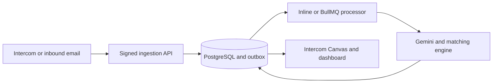

# HR Intelligence — AI-Powered B2B HR Intelligence Platform

HR Intelligence is an AI-Powered B2B HR Intelligence Platform for organizations using Intercom and email. It turns fragmented HR conversations into structured, explainable case intelligence: classification, employee identity resolution, related history, stakeholder context, routing, and auditable human-reviewed outcomes.

## Problem → solution → impact

Before this layer, HR operations teams could spend repetitive effort reading long conversations, identifying an employee from inconsistent names, searching related history, looking up store and stakeholder context, and carrying findings between systems. HR Intelligence normalizes Intercom, inbound email, and reviewer sample intake, structures the case, preserves deterministic identity evidence, surfaces related history and routing context, and keeps the operator in Intercom.

The defensible organizational value is centralized case intelligence, reduced repetitive lookup work, safer handling of uncertain identity matches, consistent team workflows, better traceability, and recoverable asynchronous work. This environment does not claim unmeasured savings, production volume, or customer outcomes.

[View the HR Intelligence product walkthrough](https://nagumo-hr-intelligence.vercel.app)


## Platform capabilities

- Signed Intercom webhook ingestion and embedded Canvas Kit workflows
- LLM-assisted extraction with deterministic fixture mode and confidence-based review
- Exact, alias, token, and fuzzy employee-name resolution
- Related-case retrieval with explainable evidence and time-window controls
- Store-directory routing and CC-recipient suggestions
- Idempotent inbound-event recording, transactional outbox dispatch, retries, and recovery
- Role-based dashboard access for administrators and read-only reviewers
- Public synthetic demo sessions with request limits and data retention controls
- A site-wide read-only “Ask HR Intelligence” assistant with public product help and role-gated case, operations, directory, and fixture-evaluation context
- Invite-controlled authentication: no public signup, no exposed reviewer password, and a short-lived server-issued reviewer walkthrough

## Architecture



The same application service processes work inline for a low-cost demo deployment or through BullMQ workers for an asynchronous production topology. PostgreSQL remains the source of truth in both modes.

## Repository layout

```text
Intercom-app/
├── backend/
│   ├── src/
│   │   ├── config/       Environment, database, logging, Redis and provider configuration
│   │   ├── database/     Drizzle schemas, connection management and startup schema checks
│   │   ├── middlewares/  Authentication, RBAC, validation, rate limiting and signatures
│   │   ├── modules/      Feature-oriented domain and application modules
│   │   ├── jobs/         Background worker entry points
│   │   ├── queues/       BullMQ dispatch adapters
│   │   └── routes/       API and provider route composition
│   ├── scripts/          Migrations, seeds, evaluations and integration smoke tests
│   └── tests/            Unit, integration, contract and end-to-end tests
└── web/
    ├── app/              Next.js App Router pages and route-level error/loading UI
    ├── components/       Workspace, landing-page and product-walkthrough components
    ├── lib/              Typed API, authentication and display utilities
    └── public/           Sanitized product evidence
```

## Technology

| Layer            | Technology                                             |
| ---------------- | ------------------------------------------------------ |
| Frontend         | Next.js, React, TypeScript, Tailwind CSS               |
| API              | Node.js, Express, TypeScript, Zod                      |
| Data             | PostgreSQL, Drizzle ORM, pgvector, trigram search      |
| Async processing | BullMQ and Redis, with an inline deployment mode       |
| Integrations     | Intercom, Gemini, Box and optional inbound email       |
| Quality          | Jest, Supertest, ESLint, TypeScript and GitHub Actions |

## Security and reliability

- HMAC verification is applied to Intercom and inbound-email webhooks before parsing.
- Access and refresh tokens have separate secrets, issuer and audience validation.
- Refresh tokens use secure, HTTP-only cookies; dashboard authorization is enforced by backend RBAC.
- Passwords are bcrypt-hashed and are excluded from API projections.
- Production configuration validates required secrets and provider dependencies at startup.
- Rate limits protect authentication, public demos, webhooks and invitation requests.
- Synthetic reviewer records are isolated from real customer and employee data.
- The assistant uses bounded Zod-validated inputs, existing auth/RBAC boundaries, deterministic read-only tools, and never receives raw provider payloads, secrets, SQL, shell access, or mutation capabilities.

See [the product audit](docs/PRODUCT_AUDIT.md) for the problem/value matrix and recruiter-facing presentation decisions. See [recruiter evidence](docs/RECRUITER_EVIDENCE.md) for the evidence boundary and claims that should not be made.

## Local development

Requirements: Node.js 20+, Docker, and npm.

```bash
cd Intercom-app/backend
cp .env.example .env
docker compose up -d
npm ci
npm run db:push
npm run dev
```

In another terminal:

```bash
cd Intercom-app/web
cp .env.example .env.local
npm ci
npm run dev
```

The web application runs at `http://localhost:3001`; the API runs at `http://localhost:3002`.

## Verification

```bash
cd Intercom-app/backend
npm run lint
npm run typecheck
npm test
npm run build

cd ../web
npm run lint
npm run typecheck
npm run build
```

The reviewer account is intentionally read-only. Intercom access is separately approved because Intercom performs identity verification for new teammates.

> This repository and its hosted product walkthrough use synthetic data only. Provider secrets and production credentials are never committed.
