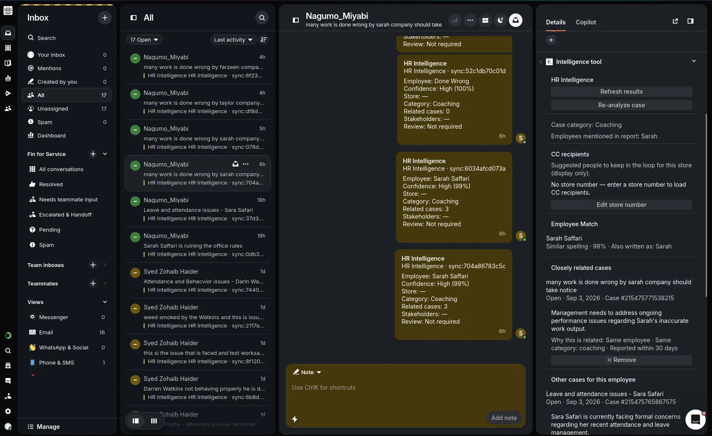
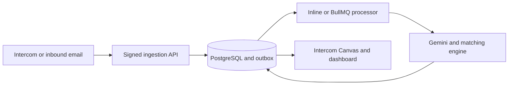

# HR Intelligence

HR Intelligence turns employee-related Intercom conversations into structured, reviewable HR case intelligence. It classifies the reported concern, resolves employee identity against a directory, suggests store-aware recipients, and surfaces related case history with transparent matching evidence.

[View the live recruiter showcase](https://nagumo-hr-intelligence.vercel.app)



## What this project demonstrates

- Signed Intercom webhook ingestion and embedded Canvas Kit workflows
- LLM-assisted extraction with deterministic fixture mode and confidence-based review
- Exact, alias, token, and fuzzy employee-name resolution
- Related-case retrieval with explainable evidence and time-window controls
- Store-directory routing and CC-recipient suggestions
- Idempotent inbound-event recording, transactional outbox dispatch, retries, and recovery
- Role-based dashboard access for administrators and read-only reviewers
- Public synthetic demo sessions with request limits and data retention controls

## Architecture



The same application service processes work inline for a low-cost demo deployment or through BullMQ workers for an asynchronous production topology. PostgreSQL remains the source of truth in both modes.

## Repository layout

```text
Intercom-app/
├── backend/
│   ├── src/
│   │   ├── config/       Environment, database, logging, Redis and provider configuration
│   │   ├── database/     Drizzle schemas, connection management and startup schema checks
│   │   ├── middlewares/  Authentication, RBAC, validation, rate limiting and signatures
│   │   ├── modules/      Feature-oriented domain and application modules
│   │   ├── jobs/         Background worker entry points
│   │   ├── queues/       BullMQ dispatch adapters
│   │   └── routes/       API and provider route composition
│   ├── scripts/          Migrations, seeds, evaluations and integration smoke tests
│   └── tests/            Unit, integration, contract and end-to-end tests
└── web/
    ├── app/              Next.js App Router pages and route-level error/loading UI
    ├── components/       Dashboard, landing-page and recruiter-demo components
    ├── lib/              Typed API, authentication and display utilities
    └── public/           Sanitized product evidence
```

## Technology

| Layer            | Technology                                             |
| ---------------- | ------------------------------------------------------ |
| Frontend         | Next.js, React, TypeScript, Tailwind CSS               |
| API              | Node.js, Express, TypeScript, Zod                      |
| Data             | PostgreSQL, Drizzle ORM, pgvector, trigram search      |
| Async processing | BullMQ and Redis, with an inline deployment mode       |
| Integrations     | Intercom, Gemini, Box and optional inbound email       |
| Quality          | Jest, Supertest, ESLint, TypeScript and GitHub Actions |

## Security and reliability

- HMAC verification is applied to Intercom and inbound-email webhooks before parsing.
- Access and refresh tokens have separate secrets, issuer and audience validation.
- Refresh tokens use secure, HTTP-only cookies; dashboard authorization is enforced by backend RBAC.
- Passwords are bcrypt-hashed and are excluded from API projections.
- Production configuration validates required secrets and provider dependencies at startup.
- Rate limits protect authentication, public demos, webhooks and invitation requests.
- Synthetic portfolio records are isolated from real customer and employee data.

## Local development

Requirements: Node.js 20+, Docker, and npm.

```bash
cd Intercom-app/backend
cp .env.example .env
docker compose up -d
npm ci
npm run db:push
npm run dev
```

In another terminal:

```bash
cd Intercom-app/web
cp .env.example .env.local
npm ci
npm run dev
```

The web application runs at `http://localhost:3001`; the API runs at `http://localhost:3002`.

## Verification

```bash
cd Intercom-app/backend
npm run lint
npm run typecheck
npm test
npm run build

cd ../web
npm run lint
npm run typecheck
npm run build
```

The recruiter account is intentionally read-only. Intercom access is separately approved because Intercom performs identity verification for new teammates.

> This repository and its hosted showcase use synthetic portfolio data only. Provider secrets and production credentials are never committed.
